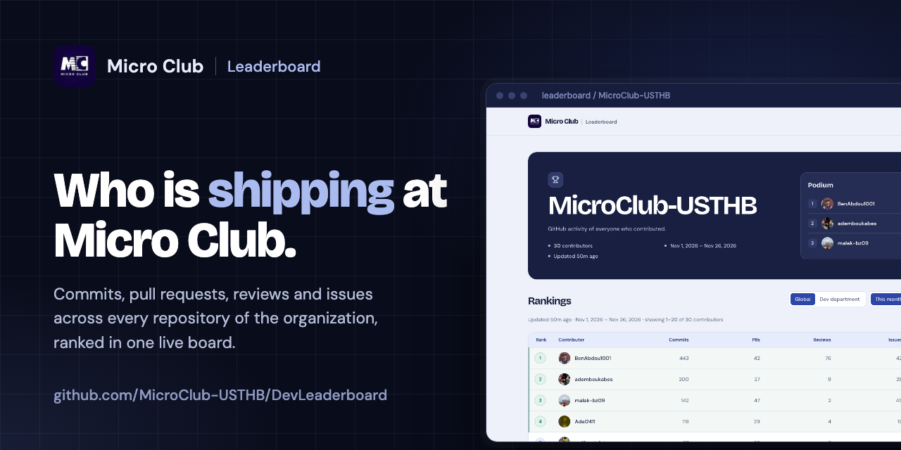
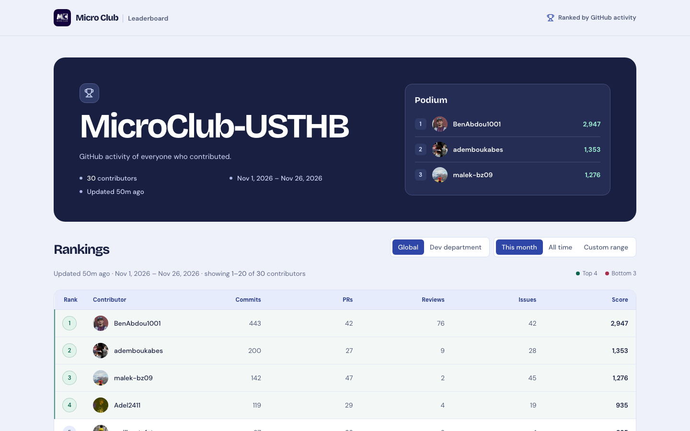

<p align="center">
  
</p>

<h1 align="center">DevLeaderboard</h1>

<p align="center">
  A live GitHub leaderboard for an organization. It ranks everyone who contributed, across <b>every
  repository and every branch</b>, by commits, pull requests, reviews and issues.
</p>

<p align="center">
  <a href="https://github.com/MicroClub-USTHB/DevLeaderboard/actions/workflows/ci.yml"></a>
  
  
  
  
  
</p>

<p align="center">
  <a href="https://leaderboard.164-68-103-224.sslip.io/"><b>Live site</b></a> &nbsp;·&nbsp;
  <a href="#quick-start">Quick start</a> &nbsp;·&nbsp;
  <a href="backend/README.md">Backend docs</a> &nbsp;·&nbsp;
  <a href="https://github.com/MicroClub-USTHB/DevLeaderboard/issues">Report an issue</a>
</p>

<p align="center">
  
</p>

---

The site opens directly on **`MicroClub-USTHB`** at `/leaderboard/MicroClub-USTHB`, with no login and no
setup screen. Any other organization can be opened by navigating to `/leaderboard/<org-login>`. The read
path never talks to GitHub: results are collected in the background, stored in MongoDB and served from
there.

## Contents

[What the app does](#what-the-app-does) ·
[Link your GitHub](#link-your-github-dev-tab) ·
[Stack](#stack) ·
[Quick start](#quick-start) ·
[Project structure](#project-structure) ·
[How it works](#how-it-works) ·
[API overview](#api-overview) ·
[Deployment](#deployment) ·
[Scripts](#scripts)

The repo contains both halves of the product:

| Folder | What it is |
|---|---|
| [`backend/`](backend/) | Express 5 + TypeScript API, MongoDB cache, GitHub collector, cron refreshes |
| [`frontend/`](frontend/) | React 19 + Tailwind v4 single-page app (dark-only) |

## What the app does

- **Opens on the club leaderboard.** `/` redirects to `/leaderboard/MicroClub-USTHB`. The header
  is a plain wordmark; there is no org switcher or search box.
- **Three timeline options** — **This month** (1st of the month, 00:00 UTC → now), **All time**
  (organization creation → now), and a **custom range** picked with From/To date inputs. The
  selection lives in the URL (`?period=month|all|custom&from=YYYY-MM-DD&to=YYYY-MM-DD&page=N`) so
  every view is shareable and bookmarkable.
- **No authentication.** Reads and refreshes are public. Refreshes are rate-limited per IP because
  they spend GitHub quota.
- **Desktop table and mobile cards** with rank, commits, pull requests, reviews, issues and the
  weighted score. The table is paginated (20 per page, server-side `offset`), and uses
  Premier-League-style zones: the top four rows are green, the bottom three are red.
- **Automatic first snapshot.** If a period has never been collected, the page gets a `202`, starts
  the refresh itself, and polls until the snapshot lands.
- **Caching with an explicit escape hatch.** The server serves `month` snapshots for 60 seconds and
  `all`/`custom` snapshots for 24 hours; the **Refresh** button sends `force=1` and always
  recomputes.
- **Resilient by design:** a stale snapshot stays on screen when GitHub or the API is
  down, with a retry hint and the server's `Retry-After`.
- **Meta panel:** scoring weights, GitHub rate-limit budget and snapshot freshness.

## Link your GitHub (Dev tab)

On the **Dev** tab a card reads "Don't see yourself here?". A member signs in with MCID, then enters
their GitHub username, and it is sent to an MCID inbound webhook that stores the link. The Dev list
is then built from MCID: members holding a Dev role, with their linked GitHub account.

- Backend: `GET /auth/login`, `GET /auth/callback`, `POST /auth/logout`, `GET /link/me`, `POST /link/github`.
  Login uses a signed single-use state cookie and a signed one-hour session cookie; the MCID API key and
  webhook secret never reach the browser.
- Turn it on with `MCID_PROJECT_ID` (plus `MCID_SERVER_ID`, `MCID_WEBHOOK_ID`, `MCID_WEBHOOK_SECRET`,
  `PUBLIC_URL`, `SESSION_SECRET`; see `backend/.env.example`). Off while `MCID_PROJECT_ID` is empty.
- Register `<PUBLIC_URL>/api/auth/callback` as a redirect URI on the MCID project.

## Stack

**Backend** — Express 5 · TypeScript (ESM) · Mongoose · Node 22+ · GitHub GraphQL API (REST
fallback for member discovery and outside collaborators) · node-cron · zod-validated config.

**Frontend** — Vite 8 · React 19 · TypeScript (strict) · Tailwind CSS v4 (`@theme` tokens) ·
React Router 7 · TanStack Query 5 · lucide-react.

## Quick start

Prerequisites: Node 22+, MongoDB (local or a MongoDB Atlas connection string), and a GitHub token.

```bash
# 1. Backend
cd backend
npm install
cp .env.example .env          # fill in GITHUB_TOKEN (+ DATABASE_* for Atlas)
npm run dev                   # http://localhost:3000

# 2. Frontend (second terminal)
cd frontend
npm install
npm run dev                   # http://localhost:5173
```

The backend refreshes `LEADERBOARD_ORGS` (default `MicroClub-USTHB`) at boot, so the first visit
already has a snapshot.

The Vite dev server proxies `/api/*` to `http://localhost:3000`, so the browser never makes a
cross-origin request and the backend needs no CORS headers.

### GitHub credentials

The collector reads a lot of data, so credentials matter. In order of preference:

1. **A GitHub App installed on the organization (recommended).** Its installation token has its own
   quota (12,500 requests an hour for a large organization) and no person's account is involved.
   Create an app under the organization's *Settings → Developer settings → GitHub Apps* with
   **read-only** permissions for *Contents*, *Issues*, *Pull requests*, *Metadata* and *Members*,
   turn the webhook off, install it on all repositories, and generate a private key. Then set
   `GITHUB_APP_ID`, `GITHUB_APP_INSTALLATION_ID` and `GITHUB_APP_PRIVATE_KEY_PATH` (the `.pem` file;
   never commit it, `*.pem` is git-ignored).
2. **A personal access token** (`GITHUB_TOKEN`). Its quota is 5,000 an hour and is shared with
   everything else that account does.
3. **A second token** (`GITHUB_TOKEN_FALLBACK`) from a different account.

A credential that cannot be minted, is rejected or is rate limited is skipped until its quota resets,
and the next one takes over.

#### Token scopes


- **Classic PAT** with `repo` + `read:org` + `read:user` — full member list, private repositories,
  and private contributions.
- **Fine-grained PAT** also works. When it cannot read organization membership, the collector
  automatically falls back to the public member list **plus the contributors of every visible
  repository** (forks included), so a public leaderboard still has real activity. Private
  repositories are counted directly when the token can see them, so private work still ranks even
  without the classic `read:user` scope.

Activity is counted from **every branch** of every visible repository, not just the default branch.
That includes unmerged feature-branch commits, PRs opened or closed/merged in the window, every
submitted review, and issues opened or solved in the window. Commits are deduplicated by SHA, so a
merge that makes the same commit reachable from several branches is counted once.

If a contributor works in a private repository the token cannot access, they cannot appear on the
board. Grant the token access to those repositories, or use a classic PAT with `repo` + `read:user`.

Club work sometimes lives in a personal repository. The default configuration counts
`MicroClub-USTHB=maito-guy/wildfire-dz` for the club board; override it with
`LEADERBOARD_EXTRA_REPOS=org=owner/repo` (comma-separated for several projects), or set it to an
empty value to keep the board strictly organization-scoped. External repositories are scanned in
full — every branch, PR, review and issue — and merged into the same board.

### Production build

```bash
cd frontend && npm run build    # static assets in frontend/dist/
```

Serve `frontend/dist/` from any static host and make sure `/api` is reverse-proxied to the backend
(the client always calls the relative path `/api/...`).

## Project structure

```
backend/
  app.ts                 Express app (helmet, routes, error handling)
  server.ts              entry point (DB connect, migration, listen, boot refresh, cron)
  routes/                Express routers (leaderboard + refresh rate-limit bucket)
  controllers/           HTTP semantics: validation, status codes, ETag, GitHub→HTTP error mapping
  services/
    leaderboard/         collector → aggregator → sync (single-flight writes, TTL cache)
    github/              typed REST/GraphQL client (timeout, backoff, rate-limit merge)
  models/                Mongoose schemas (LeaderboardSnapshot + migration)
  jobs/                  node-cron scheduler + boot refresh
  middleware/            request logging, error handling
  lib/                   structured JSON logger, bounded-concurrency helper
  config/                zod-validated config, fail-fast at boot

frontend/
  src/app/               router (root → default org), provider stack, layout, 404
  src/features/
    leaderboard/         queries + refresh mutation, timeline selector, table/cards, meta
  src/shared/
    api/                 typed DTOs and the single fetch wrapper (ApiError, ETag cache)
    lib/                 cn, formatters, UTC date helpers, org validation, toast queue
    ui/                  Button, States, Toasts
```

## How it works

1. **Collect** — the scheduler (or a public `POST /refresh`) reads every visible repository across
   every branch and counts every commit directly, deduplicated by SHA. Contributors are discovered
   from commits, PRs, reviews and issues. GraphQL's `contributionsCollection` supplies PR, review
   and issue totals, but not commits: GitHub's contribution graph omits commits it does not credit,
   so relying on it would undercount. The scan also adds PRs closed/merged after they were opened
   and issues solved by someone other than the opener. For merged PRs whose head branch was deleted
   or lives in a fork, the original commits are read from `/pulls/{n}/commits`; commits already
   credited on the base branch — including rebased copies — are recognised and skipped so a change
   is counted once. Any repository listed in `LEADERBOARD_EXTRA_REPOS` is scanned the same way and
   merged in, even though it is outside the organization. Multi-year windows are split into ≤364-day
   chunks because GitHub caps a single range at one year.
2. **Score** — commits, pull requests, reviews and issues are weighted into one number; ties break
   deterministically. Bots and zero-activity members are dropped.
3. **Cache** — the ranked list is stored per organization, period and range, with `generatedAt`,
   the organization creation date, and any collector warnings.
4. **Serve** — reads come from MongoDB only. `GET /leaderboard/:org` supports `limit`/`offset`
   pagination and sends a weak ETag derived from the snapshot, so repeat views answer
   `304 Not Modified` and reuse the cached body. A missing snapshot is a `202` with a message, not
   an error.

## API overview

All responses are JSON; errors use `{ "error": "..." }`.

| Method | Path | Description |
|---|---|---|
| `GET` | `/leaderboard/:org` | Snapshot from Mongo (never hits GitHub). `?period=month\|all\|custom&limit=1..100&offset=0..`, plus `from`/`to` for `custom`. Supports ETag/304 |
| `GET` | `/leaderboard/:org/meta` | Score weights, GitHub rate-limit budget, organization creation date, snapshot freshness |
| `POST` | `/leaderboard/:org/refresh` | Trigger a refresh (spends GitHub quota). `?period=…`, `from`/`to` for custom, `force=1` to bypass the cache |
| `GET` | `/health` | `{ "status": "ok" }` |

## Deployment

Production runs as a Docker Compose stack (backend, frontend, MongoDB) behind a Caddy reverse proxy.

- [`deploy/compose.prod.yml`](deploy/compose.prod.yml) is the stack. Only the frontend is published (on
  `127.0.0.1`); MongoDB sits on an internal network with no published port.
- [`deploy/.env.production.example`](deploy/.env.production.example) lists every variable. Copy it to
  `/opt/leaderboard/.env` on the server (`chmod 600`) and fill it in.
- [`deploy/leaderboard.caddy`](deploy/leaderboard.caddy) is the Caddy site (TLS is automatic).
- CI builds both images on every push to `main` and pushes them to GHCR; a host Watchtower pulls the new
  `latest` and recreates the containers.
- The GitHub App private key is mounted read-only into the backend (`GITHUB_APP_KEY_FILE`).

## Scripts

Run from `backend/`:

| Command | Purpose |
|---|---|
| `npm run dev` | Dev server with watch (`tsx watch`) |
| `npm run build` | Compile to `dist/` |
| `npm start` | Run the compiled server |
| `npm run typecheck` | Strict type check |

Run from `frontend/`:

| Command | Purpose |
|---|---|
| `npm run dev` | Vite dev server with the `/api` proxy |
| `npm run build` | Type-check and emit static assets to `dist/` |
| `npm run preview` | Serve the production build locally |
| `npm run typecheck` | Strict type check |
| `npm run lint` | ESLint (flat config) |

---

Full backend documentation — environment variables, scoring formula, periods, caching, scheduling,
failure behavior and logging — is in [`backend/README.md`](backend/README.md).
